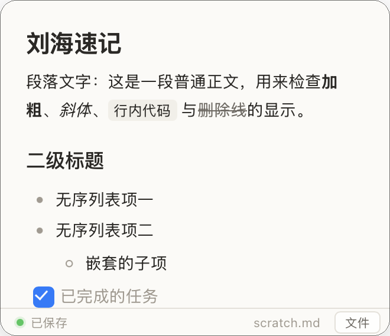
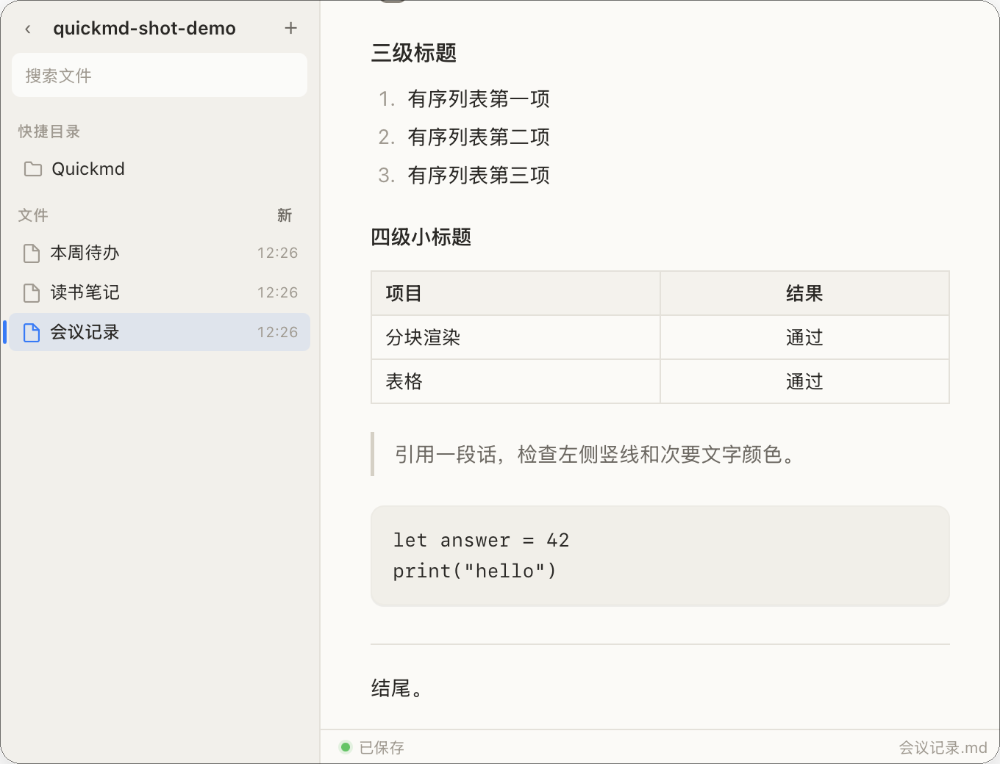
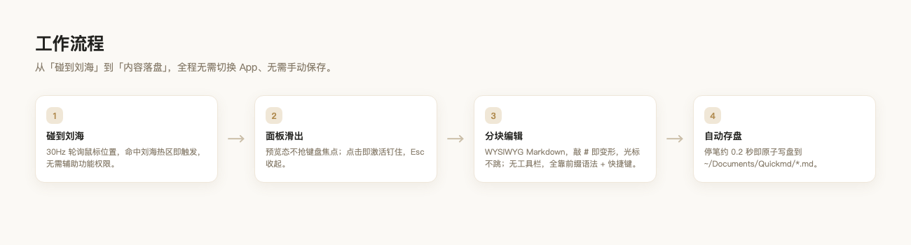

<p align="center">
  
</p>

<h1 align="center">Quickmd</h1>

<p align="center">
  <b>刘海一碰就出来的 Markdown 快速便签。</b><br>
  不换 App · 不占程序坞 · 内容就是纯 <code>.md</code> 文件
</p>

<p align="center">
  
  
  
  
</p>

---

## 这是什么

Quickmd 是一个常驻 macOS 菜单栏的超小工具：把鼠标移到屏幕顶部**刘海**上，一块便签面板就会滑出来。点一下直接打字，**Esc 收起，内容已自动存盘**。

它想解决的问题很简单——**记一句话不该打开一个 App**。所以它没有主窗口、不占程序坞、不需要切换应用；写下的内容就是普通 Markdown 文件，任何编辑器都能打开。

要整理笔记时，点右下角「文件」展开成**访达式两栏**：左边快捷目录 + 文件列表 + 搜索，右边直接编辑。

<p align="center">
  
  
</p>

## 🎬 工作流程

<p align="center">
  
</p>

从碰到刘海到内容落盘，全程无需切换 App、无需手动保存。

## ✨ 主要特性

- **刘海即入口**：鼠标碰到刘海本体（实测 179×36pt 热区）即唤出，误触低；30Hz 轮询鼠标位置，**零辅助功能权限**。
- **分块 WYSIWYG**：备忘录式手感，敲 `#` 前缀立刻变形，**光标不跳**。
- **无工具栏**：界面只剩编辑区，所有格式靠「前缀语法 + 快捷键」，干净直接。
- **自动存盘**：停笔约 0.2 秒自动原子写盘，Esc 收起时也会立即保存。
- **纯 `.md`**：文件落在 `~/Documents/Quickmd/`，不锁定、不加密、不依赖本 App。
- **文件夹即工作区**：可指定任意文件夹，侧栏按「快捷目录 + 文件列表 + 搜索」浏览，点一下就打开；快捷目录会记住，下次直接进来。
- **新建不用起名**：点「新」先按当天日期建文件，等你写出 `# 标题` 后**文件名自动跟着改**（重名自动 `-2`，不覆盖）。
- **外部改动跟得上**：用 Obsidian / AI Agent 改了正在打开的笔记，Quickmd 会自动重载；文件被外部删掉则停止写盘并标红，不会把文件「复活」。
- **格式够用**：标题 h1–h6、有序/无序/任务列表、引用、代码块、分隔线、加粗斜体删除线、链接、**表格**、**图片**（粘贴自动落盘，存相对路径）。
- **极小极轻**：App 约 1.3MB，日常内存约 34MB。
- **开机自启**：菜单栏可随时开关（`SMAppService`，失败自动降级 `LaunchAgent`）。

## 🚀 快速开始

需要 macOS 14+ 与 Xcode Command Line Tools（无需完整 Xcode）。

```bash
cd Quickmd
./build.sh            # swift build + 打包 .app
open Quickmd.app      # 运行
```

> 首次运行会在 `~/Documents/Quickmd/` 创建一张空白便签 `scratch.md`。

### 开发模式

```bash
cd Quickmd
./dev.sh              # 退出旧版 → 重建 → 启动最新代码
./dev.sh stop         # 仅退出
./dev.sh --show-now   # 重建启动并带诊断参数
```

## ⌨️ 怎么用（速查）

**没有工具栏。** 格式靠「敲前缀自动变形」或「快捷键」。

| 想要 | 敲这个 | 快捷键 |
|---|---|---|
| 一 / 二 / 三级标题 | `# ` `## ` `### ` + 空格 | ⌘1 / ⌘2 / ⌘3 |
| 四到六级标题 | `#### ` … `###### ` + 空格 | — |
| 有序列表 | `1. ` + 空格 | ⌘8 |
| 无序列表 | `- ` 或 `* ` + 空格 | ⌘7 |
| 任务清单 | `- [ ] ` / `- [x] ` + 空格 | 点勾选框切换 |
| 引用 | `> ` + 空格 | ⌘9 |
| 加粗 / 斜体 / 删除线 | `**文**` `*文*` `~~文~~` | ⌘B / ⌘I / ⇧⌘X |
| 分隔线 | `---` | — |
| 表格 | 直接粘一个 Markdown 表格进来 | 格内 Tab 跳格、回车加行 |
| 图片 | 直接粘贴图片 | 自动存进 `assets/`，md 里写相对路径 |
| 续号 / 缩进 | 回车自动续号 | Tab / ⇧Tab |
| 打开别的 .md | 点侧栏文件，或 ⌘O 选文件 | — |
| 展开文件列表 | 点右下角「文件」 | — |
| 收起（自动存盘） | — | Esc |

> **有序列表按 Typora 的规矩**：写 `1. ` 回车变 `2.`，再回车变 `3.`；写 `3. ` 就从 3 开始，存盘重开后序号不丢。空列表项上再回车则退出列表。

## 🗂 项目结构

```text
Quick-md/
├── Quickmd/                # App 源码（SwiftPM，无 Xcode 工程）
│   ├── Sources/Quickmd/    # 入口 / 面板 / 编辑器 / 刘海触发 / 存储 / 菜单栏
│   ├── Resources/          # editor-core.js（纯函数内核）/ editor.js / html / css
│   ├── build.sh / dev.sh
│   └── Tests/              # 103 项 Node 单测
├── assets/icons/           # 应用图标
├── tools/                  # 图标生成脚本（可复现）
├── docs/                   # 调研与实现说明
└── MAP.md                  # 项目地图
```

## ⚠️ 已知边界

- 侧栏只列**当前目录**的 `.md`，不递归子目录、不显示图片附件。
- 不支持脚注 / 公式 / Mermaid（快速便签用不到，加了也没人维护）。
- 代码块无语法高亮（保留语言标签）。
- 单活动文档：打开新文件即切换。
- 面板两形态尺寸固定：快捕 330×285（刘海下面就那么大）、浏览 680×520。

## 📄 License

本项目采用 [MIT License](LICENSE)。

---

<p align="center"><sub>Quickmd · Markdown at the notch · macOS menu bar</sub></p>
